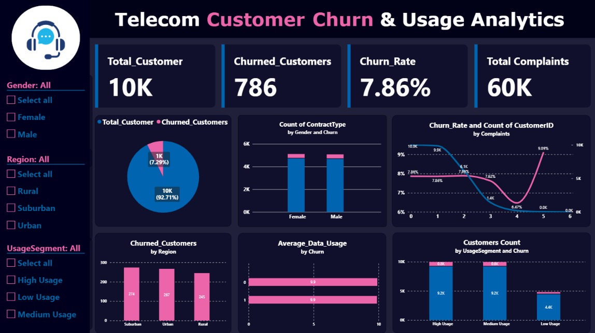

# Telecom Customer Churn & Call Center Analytics

## 📊 Project Overview
This project presents an end-to-end Business Intelligence dashboard built in Power BI to analyze telecom customer churn, call center performance metrics, and the correlation between customer complaints and churn rates.

## 🔑 Key Metrics & KPIs
- **Total Customers:** 10K
- **Churned Customers:** 786 (7.86% Overall Churn Rate)
- **Total Complaints:** 60K (Averaging high complaint frequency per customer)
- **Core KPIs Tracked:** Churn Rate, First Contact Resolution (FCR), Average Handling Time (AHT).

## 🚀 Key Business Insights
1. **The Breaking Point:** Data analysis revealed that customer churn spikes significantly up to **9.09%** when a customer reaches **5 complaints**, indicating a critical failure in resolving issues early.
2. **Volume Impact:** While 5 complaints show the highest percentage risk, the majority of absolute customer loss comes from lower complaint tiers due to high overall volume.
3. **Demographics:** Churn is evenly distributed across regions and genders, proving the issue is operational (service/support quality) rather than demographic.

## 🛠️ Tools & Technologies Used
- **Power BI:** Data Modeling, DAX measures, Interactive Visualizations (Combo charts, Slicers).
- **DAX Functions:** `CALCULATE`, `DIVIDE`, `DISTINCTCOUNT`.
- **Data Modeling:** Star schema / Relationship management to fix filter contexts.

## 📷 Dashboard Preview

